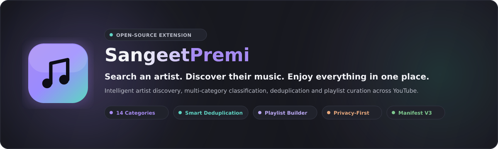
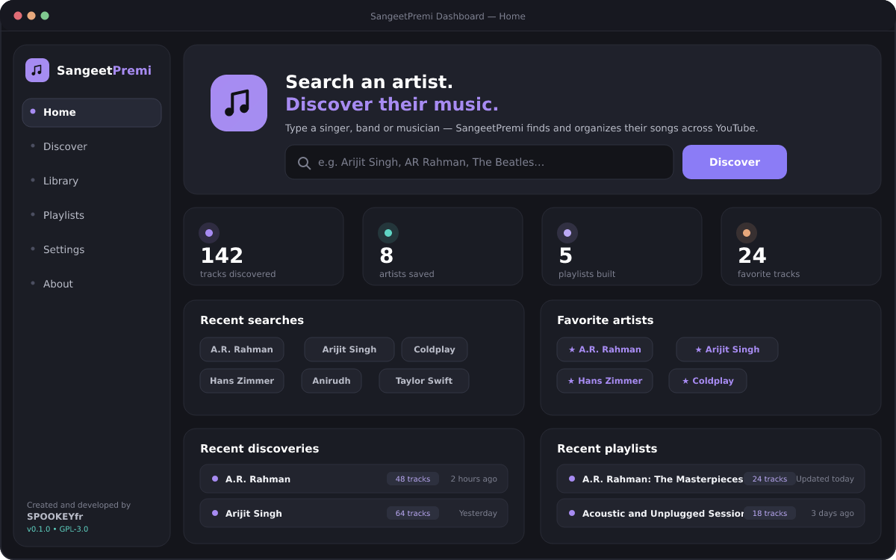
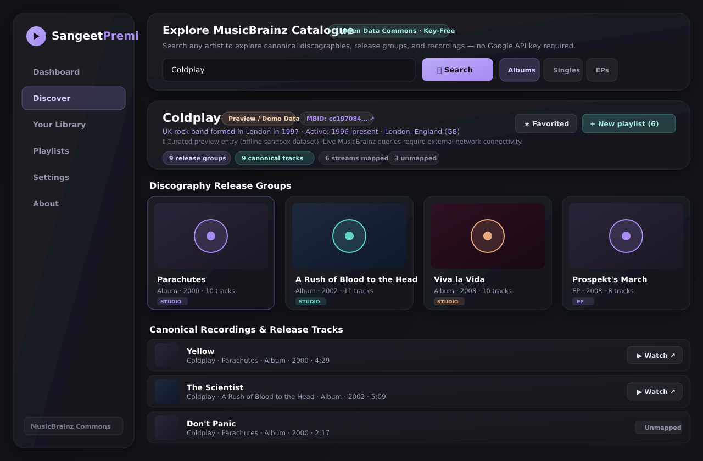
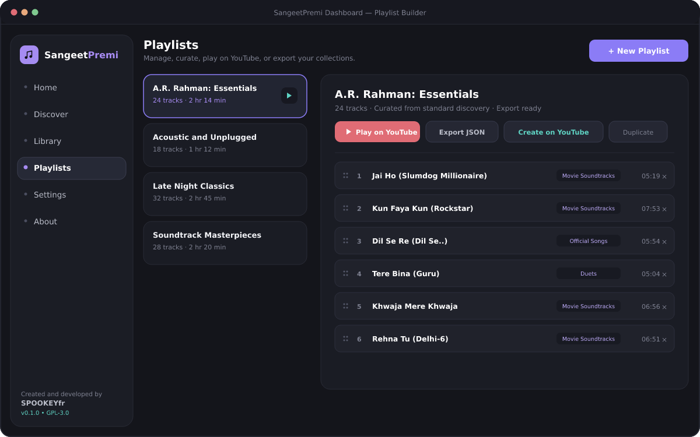
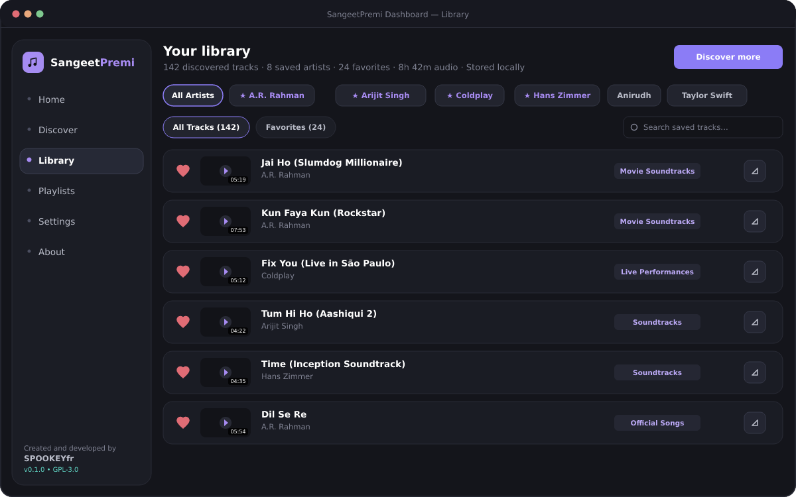
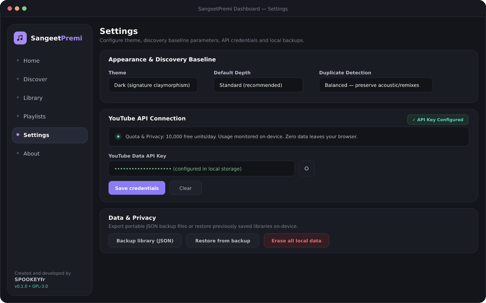
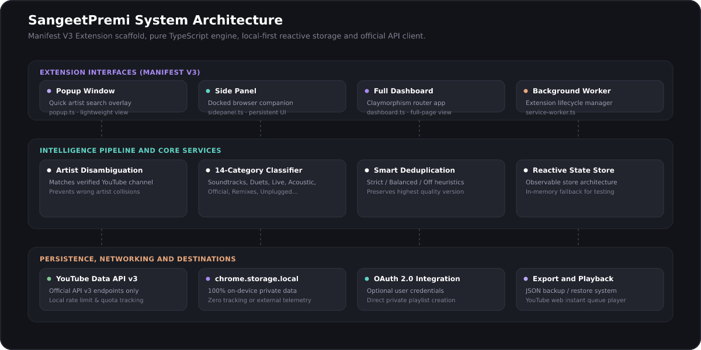

<div align="center">



# SangeetPremi

**Search an artist. Discover their music. Enjoy everything in one place.**

[](LICENSE)
[](src/manifest.ts)
[](tsconfig.json)
[](tests/)
[](package.json)
[](package.json)
[-informational.svg)](#installation)

<p align="center">
  <a href="#overview">Overview</a> •
  <a href="#interface-preview">Interface Preview</a> •
  <a href="#features">Features</a> •
  <a href="#how-it-works">How It Works</a> •
  <a href="#technology-stack">Tech Stack</a> •
  <a href="#installation">Installation</a> •
  <a href="#youtube-data-api-setup">API Setup</a> •
  <a href="#development">Development</a> •
  <a href="#architecture">Architecture</a> •
  <a href="#privacy-and-api-usage">Privacy</a> •
  <a href="#roadmap">Roadmap</a> •
  <a href="#contributing">Contributing</a> •
  <a href="#license">License</a>
</p>

</div>

---

## Overview

**SangeetPremi** is an open-source browser extension engineered for intelligent, automated music discovery across YouTube. Created and developed by **SPOOKEYfr**, SangeetPremi transforms how listeners explore an artist's catalog.

When searching for a musical artist on YouTube, listeners often encounter fragmented search results, unofficial re-uploads, audio duplicates, and missing discography tracks buried across soundtracks, collaborations, and regional releases. 

SangeetPremi solves this with a purpose-built discovery pipeline:

1. **Disambiguates** the artist against verified channels to avoid name collisions.
2. **Conducts multi-layered discovery** across official releases, film soundtracks, duets, live concert performances, acoustic versions, and remixes.
3. **Classifies** every track into 14 distinct musical categories.
4. **Applies heuristic deduplication** to remove redundant uploads while keeping the highest-fidelity recording.
5. **Generates an organized, playable collection** that can be saved locally, exported to JSON, played instantly on YouTube, or created as a real YouTube playlist.

All discovery and library data is stored locally on your device with **zero telemetry** and **zero runtime dependencies**.

---

## Interface Preview

SangeetPremi features a **Claymorphism dark design system** tailored for focused, tactile music exploration across browser popups, side panels, and the full-page dashboard.

### Main Dashboard
The centralized control center providing quick artist discovery, discovery statistics, saved artist pins, recent searches, and recent playlists.

<p align="center">
  
</p>

### Artist Discovery
Deep catalog discovery showing artist disambiguation, depth selection (Quick / Standard / Deep), 14-category filtering, duplicate review, and track curation.

<p align="center">
  
</p>

### Playlist Builder & Curation
Manage custom collections, reorder tracks, review duration summaries, and export playlists directly to YouTube or portable JSON backup files.

<p align="center">
  
</p>

### Persistent Library & Favorites
Access saved artists, starred tracks, and complete discovery session history stored on-device in `chrome.storage.local`.

<p align="center">
  
</p>

### Settings & Credential Transparency
Manage discovery baselines, theme preferences, local JSON backups, and secure on-device YouTube API keys with quota monitoring.

<p align="center">
  
</p>

---

## Features

Every feature listed below is fully implemented and tested in the repository:

- 🎤 **Intelligent Artist Disambiguation**  
  Queries verified YouTube channel metadata, subscriber metrics, and catalog hints before initiating discovery to ensure SangeetPremi never silently discovers the wrong artist.

- 🏷️ **14-Category Classification Engine**  
  Pattern-matches titles, descriptions, and artist roles to classify tracks into:
  - *Official Songs*, *Album Tracks*, *Singles*, *Movie Soundtracks*
  - *Collaborations*, *Featured Appearances*, *Duets*
  - *Live Performances*, *Acoustic Versions*, *Unplugged Sessions*
  - *Remixes*, *Cover Versions*, *Instrumental Versions*, *Other Recordings*

- 🧹 **Multi-Mode Heuristic Deduplication**  
  Detects duplicate uploads, live duplicates, and alternate audio encodings with configurable strictness (*Strict*, *Balanced*, *Off*). Retains the highest-quality representative track while allowing filtered duplicates to be reviewed and restored.

- 📀 **Full-Featured Playlist Builder**  
  Assemble custom tracklists from discovery results. Reorder, duplicate, rename, or delete playlists. Launch an instant YouTube web queue or create a private playlist directly on YouTube via optional OAuth.

- 🗂️ **Local-First Persistent Library**  
  All discovered tracks, artist bookmarks, favorite songs, and past sessions persist locally in `chrome.storage.local`. Full export and import support via JSON backups.

- 🧱 **Claymorphism Dark Design System**  
  Cohesive design language utilizing soft volumetric shadows, lavender/violet accents (`#A78BF2`), coordinated purples, and deep graphite backgrounds (`#101115`, `#191A20`).

- 🔒 **Privacy-First & Zero Telemetry**  
  No tracking scripts, no third-party telemetry, and no hardcoded backend servers. The extension communicates solely with the official Google YouTube Data API v3 using credentials you supply.

---

## How It Works

SangeetPremi executes a structured, multi-phase discovery pipeline:

<p align="center">
  
</p>

### Discovery Pipeline Stages

1. **Disambiguation Phase**  
   The user enters an artist name. SangeetPremi queries YouTube channel search to verify the artist's identity, canonical name, and channel ID. If multiple candidates exist, the user confirms the intended artist.

2. **Targeted Search Matrix**  
   Depending on the chosen depth (*Quick*, *Standard*, or *Deep*), the engine constructs targeted queries across official discographies, soundtrack appearances, live shows, and collaborative works, observing strict YouTube API rate limits.

3. **Title Normalization & Classification**  
   Raw video titles are cleansed of promotional tags (e.g., `[Official 4K Video]`, `(Lyrical Audio)`, `Full Song`). The engine extracts artist roles (primary, featured, playback singer) and assigns each track to one of 14 categories.

4. **Clustering & Deduplication**  
   Normalized titles and audio metadata form unique deduplication keys. Songs sharing the same canonical root are clustered together; the highest-ranked version is retained, and duplicates are marked with an optional review toggle.

5. **Storage & Actionable Output**  
   The resulting catalog is committed to the local state store and presented in the UI with instant filtering, bulk selection, playlist creation, and export capabilities.

---

## Technology Stack

SangeetPremi is built with modern, standards-compliant web technologies and zero runtime bloat:

| Layer | Technology | Details |
| ----- | ---------- | ------- |
| **Language** | [TypeScript 5.6](https://www.typescriptlang.org/) | Strict type checking (`noImplicitAny`, strict null checks) |
| **Bundler & Dev Server** | [Vite 5.4](https://vitejs.dev/) | Lightning-fast module compilation and HMR |
| **Extension Framework** | [@crxjs/vite-plugin 2.2](https://crxjs.dev/vite-plugin) | Manifest V3 build orchestration |
| **Test Suite** | [Vitest 2.1](https://vitest.dev/) | 35 automated unit tests covering engine logic |
| **Styling** | Native CSS3 Tokens | Custom Claymorphism primitives, zero heavy CSS frameworks |
| **Storage** | Chrome Storage API | `chrome.storage.local` with in-memory fallback for testing |
| **API Integration** | YouTube Data API v3 | Official Google API client with local quota tracking |
| **Runtime Dependencies** | **0** | Pure browser JavaScript; lightweight footprint |

---

## Installation

> **Note on Release Availability**: SangeetPremi is currently in active developer preview (MVP functional). There is currently **no published Chrome Web Store listing or pre-compiled binary release**. To try SangeetPremi, please load the extension from source in developer mode.

### Prerequisites

- **Node.js**: version `18.0.0` or higher (Node 20+ LTS recommended)
- **npm**: version `9.0.0` or higher
- **Chromium Browser**: Google Chrome, Brave, Microsoft Edge, or Chromium

### Build and Load from Source

1. **Clone the repository**:
   ```bash
   git clone https://github.com/SPOOKEYfr/sangeetpremi.git
   cd sangeetpremi
   ```

2. **Install development dependencies**:
   ```bash
   npm install
   ```

3. **Compile the extension**:
   ```bash
   npm run build
   ```
   This compiles TypeScript code and bundles the production extension into the `dist/` directory.

4. **Load the extension in your browser**:
   - Open your Chromium-based browser and navigate to `chrome://extensions` (or `edge://extensions` / `brave://extensions`).
   - Enable **Developer mode** using the toggle switch in the upper-right corner.
   - Click the **Load unpacked** button in the top toolbar.
   - Select the `dist/` directory inside your cloned `sangeetpremi` repository.

5. **Pin and Open**:
   - Click the Extensions puzzle icon in your browser toolbar and pin **SangeetPremi**.
   - Click the SangeetPremi icon to open the quick popup, open the Side Panel, or right-click &rarr; **Options** to launch the full-screen Dashboard.

---

## YouTube Data API Setup

Live music discovery requires connection to the official Google YouTube Data API v3. In accordance with open-source security best practices, **no shared API keys are included in this repository**. You provide your own free key:

1. Visit the [Google Cloud Console](https://console.cloud.google.com/) and create a free project.
2. Enable the **YouTube Data API v3** under *APIs & Services &rarr; Library*.
3. Generate an API Key under *APIs & Services &rarr; Credentials &rarr; Create Credentials &rarr; API key*.
4. Open SangeetPremi, navigate to **Settings &rarr; YouTube connection**, paste your key, and click **Save credentials**.
5. *(Optional)* For direct playlist creation on your YouTube account, configure an OAuth 2.0 Client ID under the same Settings pane.

> **Quota Awareness**: Google provides 10,000 free quota units per day. A standard SangeetPremi discovery run consumes approximately 1,000 units (~10 search requests). SangeetPremi monitors quota consumption locally and prevents quota exhaustion errors. For complete guidance, see [`docs/SETUP_YOUTUBE_API.md`](docs/SETUP_YOUTUBE_API.md).

---

## Development

The project includes pre-configured scripts for rapid development, testing, and packaging:

```bash
# Start Vite development server with Hot Module Replacement (Dashboard)
npm run dev

# Run TypeScript strict type-checking and production build to dist/
npm run build

# Execute automated unit test suite
npm test

# Run Vitest in interactive watch mode
npm run test:watch

# Perform strict typecheck across codebase
npm run lint

# Compile production build and package into a versioned .zip archive
npm run package
```

### Automated Test Suite

The test suite validates the core intelligence pipeline without requiring network connectivity:

```bash
npm test
```

Tests cover:
- `tests/normalize.test.ts` — Title sanitization, feat/duet detection, duration formatting
- `tests/classify.test.ts` — Categorization across 14 music categories and role detection
- `tests/dedup.test.ts` — Clustering heuristics, strict/balanced/off modes, representative selection
- `tests/sanitize.test.ts` — HTML escaping, URL generation, XSS prevention
- `tests/storage.test.ts` — Reactive store persistence and backup/restore roundtrips

---

## Architecture

```
sangeetpremi/
├── .github/                     # GitHub issue templates, PR template & workflows
│   ├── ISSUE_TEMPLATE/
│   │   ├── bug_report.yml       # Structured bug report form
│   │   ├── feature_request.yml  # Structured feature request form
│   │   └── config.yml           # Issue configuration & security links
│   └── PULL_REQUEST_TEMPLATE.md # Standard PR checklist
├── docs/                        # Architectural documentation & assets
│   ├── assets/                  # Hero banners, logo emblems, diagrams & screenshots
│   ├── PROJECT_STATUS.md        # Comprehensive phase checklist & implementation status
│   └── SETUP_YOUTUBE_API.md     # Step-by-step Google Cloud credentials guide
├── public/                      # Static extension assets & icons
│   └── icons/                   # Generated brand icons (16, 32, 48, 128px)
├── src/
│   ├── app/                     # Full-screen Dashboard application shell & hash router
│   ├── components/              # Reusable UI components (track cards, modals, toast, icons)
│   ├── extension/               # Chrome MV3 entry points (popup, sidepanel, worker, content)
│   ├── features/                # Domain views (Home, Discover, Library, Playlists, Settings, About)
│   ├── services/                # YouTube API client, OAuth, Discovery Engine, Storage, Config
│   ├── state/                   # Reactive observable store with storage synchronization
│   ├── styles/                  # Claymorphism design system tokens, base, and components
│   ├── types/                   # Canonical TypeScript data models
│   └── utils/                   # Normalization, sanitization, and ID generators
├── tests/                       # Vitest unit test suite (35 automated tests)
├── scripts/                     # Packaging scripts (package-extension.mjs)
├── CONTRIBUTING.md              # Contributor guidelines and workflow
├── CODE_OF_CONDUCT.md           # Contributor Covenant Code of Conduct v2.1
├── SECURITY.md                  # Responsible vulnerability disclosure policy
├── LICENSE                      # GNU General Public License v3.0
└── package.json                 # Project manifest and scripts
```

---

## Privacy and API Usage

- **Local Data Only**: All discovery history, saved playlists, favorites, and settings reside in your browser's `chrome.storage.local`. No external database is used.
- **No Telemetry**: SangeetPremi contains zero analytics, behavioral trackers, or external logging beacons.
- **Official API Access**: All YouTube communication uses the official, public YouTube Data API v3 over HTTPS. SangeetPremi does not scrape web pages, bypass YouTube safeguards, or download/distribute audio files.
- **Independent Project**: SangeetPremi is an independent open-source project and is not affiliated with, sponsored by, or endorsed by Google LLC or YouTube.

---

## Roadmap

Development is tracked in detail in [`docs/PROJECT_STATUS.md`](docs/PROJECT_STATUS.md). Current progress across major project phases:

- [x] **Phase 1: Manifest V3 Foundation** — Service worker, popup, side panel, options page, and storage scaffold.
- [x] **Phase 2: Claymorphism Design System** — Custom tokens, dark theme surfaces, responsive track cards, and brand assets.
- [x] **Phase 3: Discovery Engine** — Disambiguation, YouTube API v3 client, 14-category classifier, and smart deduplication.
- [x] **Phase 4: Curation & Library** — Playlist builder, JSON export, instant YouTube queue player, and persistent library.
- [ ] **Phase 5: In-Browser Verification** *(In Progress)* — Extensive manual testing across Chromium distributions (Chrome, Brave, Edge).
- [ ] **Phase 6: Advanced Capabilities** *(Planned)* — Drag-and-drop track reordering, multi-artist comparative discovery, and genre/language filtering.
- [ ] **Phase 7: Firefox Support** *(Planned)* — Packaging with WebExtension polyfills for Mozilla Add-ons release.

---

## Contributing

Contributions from the open-source community are warmly welcomed!

1. Read our [Contributing Guidelines](CONTRIBUTING.md) and [Code of Conduct](CODE_OF_CONDUCT.md).
2. Check existing [Issues](https://github.com/SPOOKEYfr/sangeetpremi/issues) or create a new one using our templates.
3. Fork the repository, create your feature branch, and submit a Pull Request.

Please ensure all tests pass (`npm test`) and the project builds cleanly (`npm run build`) before submitting changes.

---

## License

SangeetPremi is licensed under the **GNU General Public License v3.0 (GPL-3.0)**.  
See the [`LICENSE`](LICENSE) file for the full license text.

---

## Acknowledgements

- Created and maintained by **[SPOOKEYfr](https://github.com/SPOOKEYfr)**.
- Powered by the [YouTube Data API v3](https://developers.google.com/youtube/v3).
- Built with [Vite](https://vitejs.dev/), [@crxjs/vite-plugin](https://crxjs.dev/), [TypeScript](https://www.typescriptlang.org/), and [Vitest](https://vitest.dev/).

---

<div align="center">
  <sub>SangeetPremi • An open-source music discovery project by <a href="https://github.com/SPOOKEYfr">SPOOKEYfr</a></sub>
</div>
